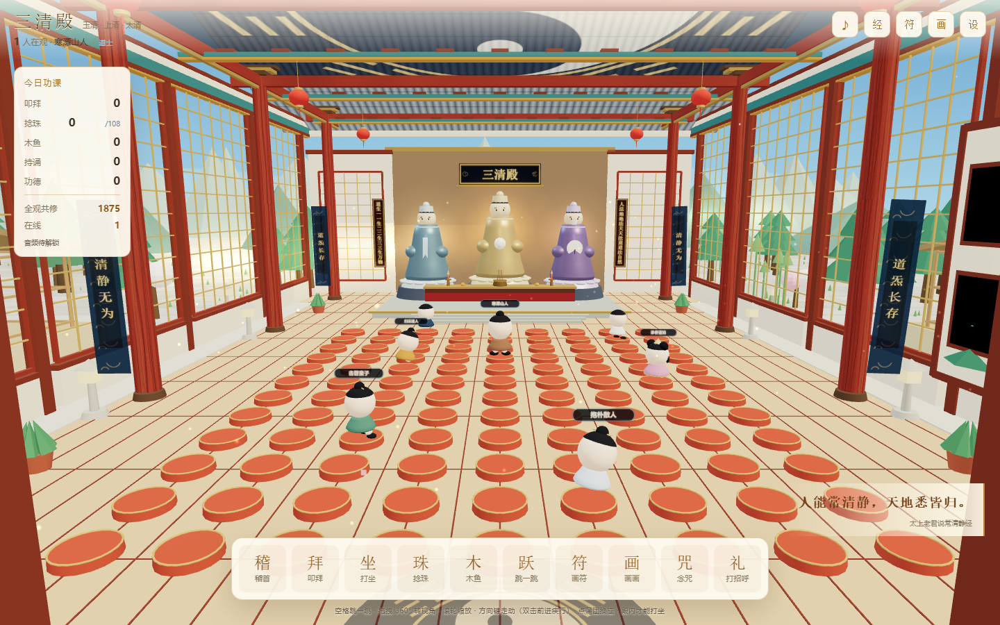

# 三清观

> 上班间隙，进来静一静。网页 3D 多人在线静心体验，道教版「线上寺庙」。
> **传统文化沉浸式体验，非宗教活动。**



> **线上地址（已部署）**
> 代码仓库：https://github.com/KunMing0228/sanqing-guan
> 静态预览（GitHub Pages · 单人静修模式）：https://KunMing0228.github.io/sanqing-guan/
> 200 人同时在线需要 Node 常驻服务，见 [DEPLOY.md](DEPLOY.md)。

韩国《山寺》(sansatemple.com) 爆红之后做的道教题材复刻。**原作确实是纯网页版**：
免下载、免注册、手机 / 电脑浏览器直接打开，3D 木造佛堂 + Q 版小沙弥 + 满地蒲团，
多人同屏但完全禁用聊天。本项目复刻的是它的**玩法机制与体验结构**，
题材换成三清殿、小道童 / 小道姑、《太上清静经》，代码、模型、贴图、音频全部原创，
不含原作任何素材。

---

## 快速开始（本机）

```bash
node server/index.js
# 打开 http://localhost:8080
```

**零 npm 依赖**，不用 `npm install`，不用构建，断网也能跑。
需要 Node.js ≥ 18（开发实测 Node 22.22.2）。

```bash
npm run smoke   # 语法 / 文件 / HTTP 端点自检
npm run bench   # 200 并发 WebSocket 压测（15 秒）
npm run geo     # 离线 IP 库抽样校验
```

自检参数：`http://localhost:8080/?preview=1` 会跳过入观页，方便无头截图与部署后验证。

---

## 能做什么

| 类别 | 内容 |
|---|---|
| 场景 | 夜色道观、重檐灰瓦、朱柱斗拱、太极八卦藻井、「三清殿」匾额与楹联、幡幢、青砖月台、三尊金身三清像（背光光晕）、供桌香炉（上升香烟粒子）、摇曳烛火、108 个蒲团、远山松柏流云星月 |
| 人物 | Q 版三头身卡通道童（圆头、点眼、腮红、短手短脚，**不做成熟写实**）；**道士 / 道姑可选**，发髻 / 莲花冠 / 裙裾 / 配色区分；呼吸、走动、盘腿打坐、俯身叩拜、合掌、画符、点头持诵、跳跃，状态平滑插值 |
| 核心交互 | 稽首、叩拜、打坐、捻珠 108、**跳一跳**、**画符**（黄纸朱砂毛笔、速度影响笔锋、撤销、敕符盖印、导出 PNG、匿名张贴符箓墙）、**念咒**（八大神咒 + 清静经逐句持诵）、**表情打招呼**、**报方位** |
| 大殿 | 进深 44、**层高 13.4（屋脊 21.3）**，人物与 108 蒲团都在殿内；**只留左右两列檐柱（8 根），殿内不立内柱**，望向三清视线是通的；格子门窗、窗棂、土墙、殿口三开间门、门簪、檐廊栏杆、台阶、悬挂宫灯、木地板、梁枋丹青、藻井、匾额楹联幡幢；双坡屋顶脊高檐低、屋面加厚压住墙顶，不会出现屋顶悬空的缝 |
| 地图 | 大地图 **156×156**，边界之外仍有远山、松树、竹丛、花树、花圃、草丛、石径、石灯笼；**8 处「建造中 · 暂未开放」区域**（脚手架、围挡、木料堆、牌匾），围挡不可进入，靠近时 HUD 提示 |
| 镜头 | 水平 **360° 无限旋转**、滚轮缩放 12~70、**焦点锁在角色身上随走随动**、射线避障（转到柱子/神像后自动拉近）；移动为**相机相对方向**（前进键永远朝镜头看的方向走） |
| 多人 | 4 殿 × 108 席 = 432 席；服务端权威分配蒲团（优先殿中心靠前）；看到别人走动 / 打坐 / 叩拜 / 跳跃 / 表情气泡；每殿 6 位守观道童，一个人打开也不空 |
| 朝向 | 打坐 / 叩拜 / 稽首 / 持诵一律**面朝三清**，走动时才自由转身，落下自动转回；服务端同步纠正，不允许各个方向乱拜 |
| 地形与碰撞 | 角色脚底跟随地形高度（上须弥台不再陷进台子）；**墙体、门扇、供案、神像区、柱子、建造区围挡全部有碰撞**，撞上贴边走、**人物不能穿墙而过** |
| 行走 | 人物有**两条腿**，走动时交替前后摆、站立自然垂下、坐下收腿露鞋；**只有双击前进键（W/↑）才疾行**，双击左右/后退或长按都只是慢走 |
| 打坐 | **只有站在大殿里才能打坐**，殿外（广场 / 山道 / 建造区）按「坐」只提示不落座；服务端同样校验 `pose=sit` 的位置，改包也坐不下 |
| 木鱼 | 殿内点「木鱼」自动就近落座并摆出木鱼与木槌，每敲一记有落槌动画 + 木鱼音 + 计数（HUD「木鱼」行，服务端权威累计） |
| 画画 | 「画画」打开白纸画布：六色笔、笔粗 2~30、撤销 / 清空 / 存为图片；**张贴到殿墙**后同殿的人都能看见（殿内右侧挂屏 6 格 + 「画墙」面板缩略图），只留最近 8 幅，纯手绘无文字输入 |
| 音频 | 无限循环音轨接口 `public/audio/qingjingjing.mp3`；无音轨时自动降级为 Web Audio 五声音阶编钟道乐；经文面板可**点「听诵读」**播放标准朗读（播放时自动压低背景）；引磬、木鱼、铜铃、落地音；点击「入观」解锁自动播放 |
| **不做** | **搭子聊天、私信、房间聊天、好友、匹配、排行榜、文字输入**——协议层就没有 `chat` 类型，未知上行类型直接丢弃，改包也发不出文字 |

**表情打招呼**：8 个固定道系表情（太极 / 稽首 / 青莲 / 祥云 / 白鹤 / 心香 / 清静 / 安泰），
只能点选枚举 ID，头顶气泡 3.5 秒消散，可朝向同殿众人或某位道童。

**报方位**：服务端用本地 `ip2region_v4.xdb` 解析国家 / 省份 / 城市，界面先显示自己的方位预览，
**只有主动点「发送」才广播**；地名完全由服务端生成，客户端只能传一个 0/1 开关。
只到城市级，不显示 IP / 经纬度 / ISP，不落盘、不写日志，解析不到如实显示「未知地域」。

---

## 技术选型

| 方案 | 性能 | 体积 / 依赖 | 生态 | 运维 | 结论 |
|---|---|---|---|---|---|
| **Node 原生 http + 自实现 WebSocket + Three.js**（采用） | 200 连接 P95 10ms | 零 npm 依赖，前端 670KB Three.js | 够用 | 单进程，一条命令启动 | **采用** |
| Socket.IO + Express + Redis | 相当，但多一层协议开销 | 数十个依赖 + Redis | 成熟 | 要装包、要维护 Redis | 200 人量级不需要，过度设计 |
| Unity / Godot WebGL 导出 | 画面上限更高 | 首包 10MB+，加载慢 | 重资产 | 需要美术与构建链 | 违背「打开网页即玩」的核心体验 |

**结论**：单进程 Node + 10Hz 增量广播 + 5s 全量快照兜底 + 按殿分广播域，
200 人同时在线的瓶颈根本不在服务端，没必要上集群。

---

## 200 人并发实测（本机，2026-11-12）

```
握手完成: 200/200 成功，失败 0，耗时 601ms
各殿分布: 三清殿:50  玉虚殿:50  紫霄殿:50  清微殿:50
掉线数:   0
RTT P50 / P95 / P99: 3ms / 10ms / 13ms
服务端 RSS: 65.7 MB
收到 tick / 快照: 15260 / 600
结论: PASS
```

复现：`npm run bench`（可用 `CLIENTS=400 DURATION=30000` 加压）。

---

## 目录结构

```
sanqing-guan/
├── server/          # 零依赖服务端
│   ├── index.js     # 静态服务 + /healthz + /metrics + /api/halls
│   ├── ws.js        # RFC6455 WebSocket（握手 / 掩码 / 分片 / ping-pong）
│   ├── room.js      # 4 殿 432 席、增量同步、限流、冷却、权威计数
│   ├── geoip.js     # 离线 xdb 读取 + 反代头信任 + 隐私处理
│   ├── config.js    # 容量 / 频率 / 冷却 / 表情 / 性别 常量
│   └── names.js     # 中文道号、道袍配色
├── public/
│   ├── index.html / css/     # 界面（含四态、375px 移动端）
│   ├── js/
│   │   ├── scene.js          # 3D 殿（全程序化几何）
│   │   ├── avatar.js         # Q 版道士 / 道姑 + 动画 + LOD
│   │   ├── fx.js             # Canvas 贴图 + 香烟 / 灵光 / 金光粒子
│   │   ├── audio.js          # 音轨 + Web Audio 合成道乐
│   │   ├── net.js            # WS 客户端 + 重连 + 静态降级
│   │   ├── talisman.js       # 画符
│   │   ├── ui.js             # DOM 层
│   │   ├── scripture.js      # 清静经 + 八大神咒（已核对权威版本）
│   │   └── main.js           # 组装、主循环、相机、键盘
│   ├── vendor/three.module.min.js   # 本地化，无 CDN
│   └── audio/                # 把 qingjingjing.mp3 放这里
├── data/ip2region_v4.xdb     # 离线 IP 库（Apache-2.0）
├── deploy/Dockerfile / nginx.conf
├── docker-compose.yml
├── .github/workflows/        # push 自动部署 / Pages 静态预览
├── tools/bench.js / smoke.js / geo-check.js
├── PROMPT.md                 # 完整项目提示词（可直接复用）
├── ASSET_PROMPTS.md          # 3D / 美术 / 音效资产提示词（只写，未执行生成）
└── DEPLOY.md                 # 服务器部署与扩容
```

---

## 部署

| 目标 | 做法 |
|---|---|
| 本机 | `node server/index.js` |
| GitHub 仓库 | `git init && git add . && git commit -m "init" && git remote add origin <你的仓库> && git push -u origin main` |
| GitHub Pages | 已配 `.github/workflows/pages.yml`；**仅静态版**，自动进入单人静修模式 |
| PaaS（支持 WebSocket） | 已配 `railway.json` / `render.yaml`，导入仓库即可 |
| 自有服务器 | `docker compose up -d --build`；也可配 Actions push 后自动 SSH 部署 |
| 详细步骤 | 见 [DEPLOY.md](DEPLOY.md) |

**平台能力边界**：GitHub Pages 只托管静态文件，跑不了 Node 常驻进程与 WebSocket，
所以「200 人同时在线」必须有服务器；Pages 版完整保留 3D 画面与全部单人交互，
但多人功能不可用，页面会如实标注。

---

## 音频的真实情况（重要）

项目**没有附带任何真人诵经录音**，也不会去下载第三方音频。当前默认：
Web Audio 实时合成的道乐氛围（低频 drone + 引磬 + 木鱼 + 风声水声）+ 经文逐句滚动，
界面明确标注「合成道乐 · 未检测到诵经音轨」。

把 **`qingjingjing.mp3`** 放进 `public/audio/` 即自动无限循环真人诵经，
合成层自动降为环境垫底。详见 `public/audio/README.md`。

---

## 隐私与合规

- 无账号、不收集姓名手机号、不写 IP 日志、不落盘个人数据，符箓只留最近 12 张且重启即清空。
- IP 只在内存里即时解析到城市级，`X-Forwarded-For` 默认完全不信（防伪造国籍），
  仅显式 `TRUST_PROXY=true` 且直连来自本机 / 私网时才读。
- 表情是枚举 ID、方位是布尔开关、道号与地名由服务端生成，协议层不存在自由文本通道。
- 不收费、不占卜、不募捐、不诱导信仰、不宣称任何宗教功效；定位为文化体验。
- 中国香港 / 澳门 / 台湾一律作为中国的一部分展示。
- 国内服务器上架需 **ICP 备案** 与平台内容审核，属外部流程，本项目只给配置不代办。

经文、咒语、第三方组件许可见 [THIRD_PARTY.md](THIRD_PARTY.md)。


---

## 与《山寺》的逐条对照（v1.3）

| 山寺特征 | 三清观 |
|---|---|
| 免下载、免注册、浏览器直接进 | ✅ 同样，零构建、零 npm 依赖 |
| 随机诗意法号 | ✅ 中文道号（清虚散人 / 松风道姑…），道士道姑两套后缀 |
| Q 版小沙弥 | ✅ Q 版三头身卡通小道童 / 小道姑，可选可随时换 |
| **3D 开放式木造佛堂** | ✅ 三清殿：格子门窗、窗棂、墙体、门框门簪、檐廊栏杆、台阶、宫灯、木地板、丹青彩画、斗拱藻井 |
| **人物在佛堂内** | ✅ 108 蒲团与全部人物都在殿内，相机在殿内后方俯看 |
| 中央金色大佛 + 背光 | ✅ 玉清 / 上清 / 太清三尊，金身背光、莲台、持物 |
| 满地参拜蒲团 | ✅ 108 个，间距加大、尺寸放大，就近入座 |
| 门外排队、踏阶入殿 | ✅ 殿口三开间门 + 三级台阶（多人入场按就近中心分配席位） |
| 合掌 / 跪拜 / 木鱼 / 念珠 108 | ✅ 稽首 / 叩拜 / 引磬 / 捻珠 108，另加跳跃、画符、念咒 |
| 零社交（无聊天好友） | ✅ 协议层无 `chat` 类型 |
| 多房间、多人同屏 | ✅ 4 殿 432 席，实测 200 人同时在线 |
| 山林自然声 + 诵经循环 | ✅ 合成道乐 + 经文诵读（本地 TTS 清晰朗读，无噪音）+ 真人格录音轨接口 |
| 背景山林、树木 | ✅ 松、竹、花树、花圃、草丛、远山、祥云、花瓣粒子 |
| 未开放 / 施工中区域 | ✅ 5 处「建造中 · 暂未开放」脚手架围挡，靠近提示 |
| 大地图、边界外仍有景 | ✅ 92×98 可走范围，边界外延伸远山与园林 |
| 自由视角 | ✅ 360° 旋转 + 跟随角色 + 滚轮缩放，双击方向键疾行 |
| 用户能近距离靠近佛像 | ✅ 可走到供案前，须弥台高度跟随不穿模 |

**刻意保留的道教化差异**：佛堂→三清殿、般若心经→《太上老君说常清静经》+ 八大神咒、
念珠→捻珠、新增画符与符箓墙、方位打招呼（IP 城市级、点击才发）。

### 新增文件

```
public/js/hall.js        # 开放式大殿 + 格子门窗墙檐廊灯笼
public/js/garden.js      # 殿外园林 + 5 处建造中区域（InstancedMesh 批量）
public/js/terrain.js     # 地形高度 + 三清朝向常量
tools/gen_recitations.py # 本机 TTS 生成干净无噪音的经文诵读 mp3
```

### 诵读音轨

`public/audio/scripture/qingjingjing.mp3`（清静经）与 `mantras.mp3`（八大神咒连读）
由本机 IndexTTS-2 生成：标准国语朗读、无配乐、已裁静音，本地免费、零版权风险。
也可自行放入 `mantra_0.mp3`…`mantra_7.mp3` 单篇音轨，播放器会优先用单篇、缺了回落合集。
重新生成：`python tools/gen_recitations.py`。

---

## 在线托管：免费平台实测（2026-11-12）

已发布到 WorkBuddy 应用托管（免费、无需额外账号，支持 Node 常驻进程 + WebSocket）：

**https://sanqing-guan.app.workbuddy.host/?sharecode=WCJBRITIS5**

> 首次打开会带 `?sharecode=...`，平台会种一个 cookie（`__wb_rsc`），之后页面里的 JS / 音频等子资源才放行。分享给别人时**要连 `?sharecode=` 一起发**，只发域名会看到「链接不完整」。

### 实测承载力（同一 IP 并发模拟，非多地区真实用户）

| 并发 | 建连成功 | 握手 P95 | 在线人数 | 广播延迟 | 结论 |
|---|---|---|---|---|---|
| 4 | 4/4 | — | 4 | 正常（3/3 收到） | 多人同步可用 |
| 60 | 55/60 | 297ms | 55 | 114ms | 可正常游玩 |
| 120 | 117/120 | 296ms（max 15.2s，排队） | 掉到 24 | 未收到 | 已过载 |

结论：**免费沙箱适合十几到几十人同时在线做展示 / 内测**，撑不住 200 人。要 200 人必须上自有服务器（本地 `tools/bench.js` 已验证 200 并发 PASS）。注意上表压测是同一出口 IP 发起，平台可能有单 IP 连接数限制，真实多用户场景会比这个宽松一些，但不要拿免费沙箱当生产。

### 方位功能在反代后的行为

`server/config.js` 的 `TRUST_PROXY` 默认改为「信任来自本机 / 私网反代的第一跳 XFF」（等价 Express 的 `loopback, linklocal, uniquelocal`）：

- 平台网关从本机转发 → 能读到真实访客 IP → 显示真实省市（实测「中国 · 北京市」）。
- 公网直连永远不信任 XFF → 外部访客伪造不了国家省份。
- 实测伪造 `X-Forwarded-For: 8.8.8.8` 重连无效（平台网关会覆盖该头），仍显示真实归属。
- 想完全关闭：`TRUST_PROXY=false`。

### 换到自有服务器

`docker compose up -d --build`（见 `DEPLOY.md`），Nginx 反代加 `proxy_set_header X-Forwarded-For $proxy_add_x_forwarded_for;` 后方位同样可用。
